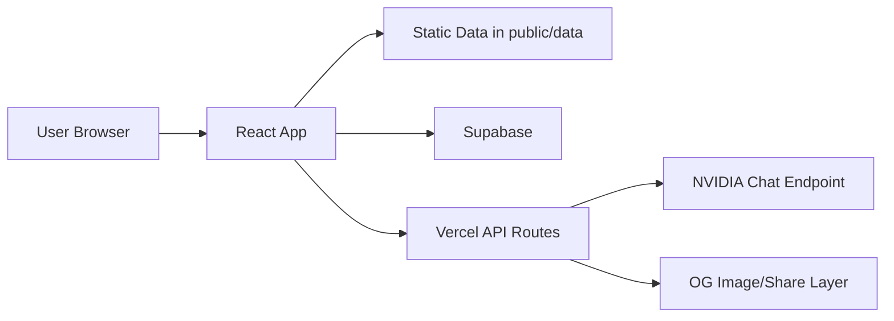

<div align="center">

# KCETCoded

Comprehensive counseling intelligence platform for KCET and COMEDK aspirants.

[](https://react.dev/)
[](https://www.typescriptlang.org/)
[](https://vitejs.dev/)
[](LICENSE)

</div>

---

## Table of Contents

- [1. Executive Summary](#1-executive-summary)
- [2. Vision, Motivation, and Scope](#2-vision-motivation-and-scope)
- [3. Product Modes (KCET and COMEDK)](#3-product-modes-kcet-and-comedk)
- [4. Feature Atlas](#4-feature-atlas)
- [5. Complete Route Map](#5-complete-route-map)
- [6. Data Foundation and Coverage](#6-data-foundation-and-coverage)
- [7. Architecture Overview](#7-architecture-overview)
- [8. Tech Stack](#8-tech-stack)
- [9. Repository Structure](#9-repository-structure)
- [10. Local Development](#10-local-development)
- [11. Script Reference](#11-script-reference)
- [12. Admin and Operations](#12-admin-and-operations)
- [13. Security, Privacy, and Trust](#13-security-privacy-and-trust)
- [14. Known Limitations and Caveats](#14-known-limitations-and-caveats)
- [15. Roadmap Direction](#15-roadmap-direction)
- [16. Additional Documentation](#16-additional-documentation)
- [17. Contributing](#17-contributing)
- [18. License](#18-license)

---

## 1. Executive Summary

KCETCoded is a student-built platform that transforms difficult-to-use counseling data into practical planning tools. It combines rank prediction, cutoff exploration, college discovery, planning/simulation, review and moderation systems, and exam-prep utilities in one product surface.

The platform now supports two operational environments:

- `KCET` mode
- `COMEDK` mode

Both are integrated into the same app shell, with mode-aware navigation, mode-aware core routes, and separate datasets.

Important: KCETCoded is an independent project and is **not an official KEA/COMEDK authority**. Always verify high-stakes decisions from official notices and source PDFs.

---

## 2. Vision, Motivation, and Scope

### Why this exists

Counseling data is public, but often operationally inaccessible to students under time pressure. KCETCoded exists to close that gap by offering:

- fast search and filtering over large cutoff datasets
- rank-to-options conversion for realistic college planning
- process support (documents, rounds, planning flows)
- source-link trust workflows for verification
- community-backed quality signals (reviews, discussions, reports)

### Problem framing

The platform is built around practical student questions:

- "What colleges are realistic for my rank/category?"
- "How did this cutoff move across rounds and years?"
- "How should I order preferences without regret?"
- "Which options are practical for commute and everyday life?"

### Product scope

KCETCoded is not a single calculator. It is a multi-surface counseling operating layer with:

- data exploration tools
- prediction tools
- planning and simulation tools
- community and moderation tools
- practice and engagement tools
- admin operations

---

## 3. Dedicated Admissions Scope & Focus

KCETCoded is currently dedicated **exclusively to Karnataka CET (Engineering & Architecture) admissions and Karnataka 2nd PUC academic excellence**.
- NEET and COMEDK admissions suites have been archived and gracefully handled with an active admissions scope notification banner (`ScopeNotification.tsx`) and redirect handler (`UnsupportedExamRedirect.tsx`).
- Legacy routes (`/neet`, `/neetcoded`, `/comedk`, `/comedk-*`) automatically redirect to `/` with an informative banner clarifying our focused KCET mission.
- The interface defaults to KCET across all dashboard, prediction, and counseling exploration tools.

---

## 4. Feature Atlas

### 4.1 Admission Intelligence & Cutoff Engineering

| Feature | Purpose | Notes |
| --- | --- | --- |
| Rank Predictor (`/rank-predictor`) | KCET expected-rank modeling from marks + PUC% with calibrated 2027 engine | Calibrated against official 2026 percentile distributions; highlights median confidence estimate & gap analysis |
| Cutoff Predictor & Round Drift (`/cutoff-predictor`, `/round-predictor`) | Mathematical round-by-round cutoff drift predictor | Simulates cutoff shifts from Mock to Round 1, Round 2, and Extended Round (Round 3) |
| Cutoff Trends (`/cutoff-trends`) | Multi-year cutoff trend visualization | Interactive Recharts multi-year (2023–2026) progression graphs with whitespace/branch normalization |
| Cutoff Explorer (`/cutoff-explorer`) | High-volume KCET cutoff search and filter engine | Source-linked PDF mapping, 269 institutions, 24 reservation categories, fast binary DataVault loading |
| College Predictor (`/college-predictor`) | Rank/category based college-branch matching | Probability sorting (Safe, Moderate, Ambitious), bookmarking, Indian numbering format, and PDF export |
| College Cutoffs (`/college-cutoffs`) | College-first matrix view | Category group filtering with live Indian number formatting (`en-IN`) |
| College Info Hub (`/colleges`) | Directory of 269+ engineering institutions | Accreditations, contact info, cutoff sheets, and dynamically calculated Hidden Gems |
| College Detail (`/college/:collegeCode`) | Per-college trend context | Branch roster, cutoff history across 2023–2026, and verified student reviews |
| College Compare (`/college-compare`) | Side-by-side college matrix | Full 24 KEA reservation categories comparative view |

### 4.2 Planning, Cost, & Official Workflow

| Feature | Purpose | Notes |
| --- | --- | --- |
| Official Fee Calculator (`/fee-calculator`) | Comprehensive 4-year tuition & living expense calculator | Updated with official KEA 2026-27 provisional fee structure; covers Govt/Aided, Unaided Type 1 & 2, Farm Science, SNQ 100% waiver, SC/ST income slabs, and hostel/mess costs |
| Mock Simulator (`/mock-simulator`) | Preference-order simulation | Simulates likely allotment outcomes using multi-year cutoffs and user priority lists |
| Round Tracker (`/round-tracker`) | Process timeline guidance & reporting checklists | Verified August 2026 dates, Choice 1–4 decision guide, and mandatory document submission checklists |
| Documents Guide (`/documents`) | Counseling checklist & verification manual | Step-by-step document readiness guidelines |
| Mock Verification (`/document-verification`) | Interactive KEA document verification simulator | Validates Rural/Kannada BEO countersignatures, study certificates, caste/income formats |

### 4.3 2nd PUC Academic Hub & Practice Suite (NEW)

| Feature | Purpose | Notes |
| --- | --- | --- |
| 2nd PUC Study Space (`/puc`) | Dedicated central hub for Karnataka 2nd PUC Science | Connects board preparation directly to KCET rank weightage |
| Official Question Banks (`/puc/question-banks`) | State-prescribed 565+ page chapter-wise question banks | Complete official question banks for Physics, Chemistry, and Mathematics |
| PYQs & Schemes of Evaluation (`/puc/pyq`, `/puc/pyq-archive`) | Official KSEAB 2nd PUC 2026 & 2025 question papers | Physics, Chemistry, and Mathematics Exam 1 & 2 papers with official model answer keys |
| In-Browser PDF Canvas Viewer | High-performance client-side PDF viewer modal | Touch drag-panning, pinch-to-zoom, fit-to-width mobile rendering, and direct downloads |
| Question Papers Library (`/puc/question-papers`) | KSEAB Model Question Papers (MQPs) archive | Indexed across multiple academic cycles with in-browser preview |
| Blueprints & Weightage (`/puc/subjects`) | Official unit & chapter-wise blueprint distributions | Teaching hours, mark distributions, and downloadable blueprint PDFs |
| Practical Scheme of Evaluation (`/puc/practicals`) | Complete 30-mark lab evaluation rubrics | Experiment rubrics, salt analysis breakdown, and viva evaluation schemes |
| PUC & KCET Marks Calculator (`/puc/marks-calculator`) | 50% KCET PCM weightage normalizer | Calculates board aggregate and projects KCET weightage contribution in real-time |
| Complete PYQ Bank (`/pyq-test`) | 68 full syllabus chapters across PCM | Physics (Ch 1–28), Chemistry (Ch 1–19), Mathematics (Ch 1–21) with LaTeX/KaTeX equation rendering |

### 4.4 AI Guidance & Knowledge Hub

| Feature | Purpose | Notes |
| --- | --- | --- |
| TesselBot AI Counselor (`/ai-counselor`) | Conversational admissions AI counselor | Integrated 269-college & 25-category in-chat dropdown wizard; grounded strictly in 2023–2026 cutoffs with zero hallucinations |
| Blog & Admissions Journal (`/blog`, `/blog/:slug`) | In-depth counseling articles and branch reviews | GFM table support, Round 2 & Extended Round decision guides |
| Info Centre (`/info-centre`) | Long-form counseling explanations | Clarifies quota rules, HK reservation, and option entry rules |
| CET News (`/cet-news`) | Curated KCET update feed | Real-time news alerts, press release summaries, and category filters |
| Materials Shelf (`/materials`) | Resource repository | Curated notes, formulas, and syllabus checklists |

### 4.5 Community, Realtime Sync, & Engagement

| Feature | Purpose | Notes |
| --- | --- | --- |
| Discussion Forum (`/forum`) | Realtime community Q&A hub for aspirants | Supabase Cloud persistence + Realtime broadcast (`kcet-forum-realtime`), verified student badges, upvoting, categories |
| Thread Detail (`/forum/thread/:id`) | Deep thread view with realtime answers | Upvoting, verified answers, student author context |
| Student Profile Hub | Cloud-synced candidate profile & cross-device Pro sync | Google OAuth + Magic Link, saves rank/PCM marks/target colleges |
| Supporters Wall (`/supporters`) | Public recognition wall for contributors | Realtime cloud list of donors and community backers with Certificate of Appreciation |
| Focus Music Player | Floating audio player with curated tracks | YouTube streaming engine, Kannada/Hindi/English study tracks, admin playlist manager with real-time sync |
| Global Community Polls | Live student voting engine | Admin-created polls for cutoff difficulty, rank inflation, and counseling experience |
| Daily Challenge & Cutoff Clash (`/daily-challenge`, `/cutoff-clash`) | Gamified learning and cutoff intuition | Daily streak tracking and higher/lower cutoff guessing challenges |
| Dino Game (`/dino`, `/game`) | Offline-style runner mini-game | Built-in relaxation mini-game for study breaks |

### 4.6 Decision Labs & Commute Tools

| Feature | Purpose | Notes |
| --- | --- | --- |
| Squad Finder (`/squad-finder`) | Group-fit college discovery for friends | Finds common college-branch options for friend groups |
| Metro Mapper (`/metro-mapper`) | Namma Metro accessibility college filtering | Identifies colleges within walking or feeder distance of Metro stations |
| BMTC Mapper (`/bmtc-mapper`) | Bus-route accessibility filtering | Bengaluru bus connectivity analysis |
| Hidden Gems (`/hidden-gems`) | Underrated/high-ROI college surfacing | High NIRF/placement value vs accessible cutoff ranks |

### 4.7 Platform, Administration, & Governance

| Component | Purpose | Notes |
| --- | --- | --- |
| Command Palette (`Ctrl/Cmd + K`) | Universal quick-search | Instantly navigates across all routes, tools, and colleges |
| Live Visitor Counter | Database-backed real-time traffic counter | Transparent active visitor counts synced with Supabase |
| Admin Hub (`/admin`) | Central operations and moderation console | Real-time page access controls, maintenance locks, site shutdown manager, music playlist manager, popup broadcaster, and poll manager |
| Dynamic Popups | Live announcement broadcast engine | Glassmorphic popup manager with route targeting and realtime trigger |
| Calibrate 2027 Modal | Next-cycle calibration interface | Helps prospective 2027 aspirants benchmark scores |

---

## 5. Complete Route Map

### 5.1 Active Routes

| Route | Component | Context | Description |
| --- | --- | --- | --- |
| `/` | `Homepage` | Standalone | Landing page with hero tools and quick discovery |
| `/dashboard` | `Dashboard` | Layout | Central command center with quick-action tools |
| `/puc` | `PucHub` | Layout | 2nd PUC Study Space central landing hub |
| `/puc/subjects` | `PucSubjects` | Layout | Blueprints, chapter weightages, and teaching hours |
| `/puc/practicals` | `PucPracticals` | Layout | 30-mark lab evaluation scheme and viva rubrics |
| `/puc/question-banks` | `PucQuestionBanks` | Layout | Official 565+ page state question banks (PCM) |
| `/puc/question-papers` | `PucQuestionPapers` | Layout | KSEAB Model Question Papers library |
| `/puc/marks-calculator` | `PucMarksCalculator` | Layout | PUC 50% KCET weightage projector |
| `/puc/study-planner` | `PucStudyPlanner` | Layout | Board study timetable planner |
| `/puc/pyq`, `/puc/pyq-archive` | `PYQArchive` | Layout | 2025 & 2026 solved PYQs with official schemes |
| `/pyq`, `/pyqs` | Redirect | — | Redirects to `/puc/pyq` |
| `/pyq-test` | `PYQTest` | Layout | Complete 68-chapter KCET PYQ practice test engine |
| `/rank-predictor` | `RankPredictor` | Layout | Marks-to-rank engine calibrated for 2026/2027 |
| `/cutoff-explorer` | `CutoffExplorer` | Layout | High-volume 2023–2026 cutoff search engine |
| `/cutoff-trends` | `CutoffTrends` | Layout | Multi-year historical cutoff graph visualizer |
| `/cutoff-predictor`, `/round-predictor` | `RoundPredictor` | Layout | Round drift simulation engine |
| `/college-predictor` | `CollegePredictor` | Layout | Rank and category college matching tool |
| `/college-finder` | Redirect | — | Redirects to `/college-predictor` |
| `/college-cutoffs` | `CollegeCutoffs` | Layout | College-first cutoff matrix |
| `/colleges`, `/college-list` | `CollegeInfoHub` | Layout | Directory of 269+ engineering colleges |
| `/college/:collegeCode` | `CollegeDetail` | Layout | College profile, branches, and cutoff history |
| `/college-compare` | `CollegeCompare` | Layout | Side-by-side comparison across 24 categories |
| `/fee-calculator` | `FeeCalculator` | Layout | KEA 2026-27 tuition and hostel fee calculator |
| `/mock-simulator` | `MockSimulator` | Layout | Option-entry allocation simulator |
| `/round-tracker` | `RoundTracker` | Layout | Live counseling timeline and reporting guidelines |
| `/documents` | `Documents` | Layout | Mandatory verification documents checklist |
| `/document-verification` | `MockVerification` | Layout | Interactive document verification checklist |
| `/reviews` | `Reviews` | Layout | Student college reviews and ratings |
| `/reviews/:collegeCode` | `CollegeReviewPage` | Layout | College-specific review list and submission |
| `/blog` | `BlogList` | Layout | Counseling admissions journal & guides |
| `/blog/:slug` | `BlogPostDetail` | Layout | Full blog article detail view |
| `/info-centre` | `InfoCentre` | Layout | Long-form KCET rules and quota guides |
| `/materials` | `Materials` | Layout | Downloadable preparation materials |
| `/cet-news` | `CETNews` | Layout | Curated KCET news updates and press releases |
| `/ai-counselor` | `AICounselor` | Layout | TesselBot AI admissions assistant |
| `/forum` | `Forum` | Layout | Realtime community Q&A discussion forum |
| `/forum/:postId` | `ThreadDetailPage` | Layout | Thread details, upvoting, and responses |
| `/squad-finder` | `SquadFinder` | Layout | Peer group college compatibility tool |
| `/metro-mapper` | `MetroMapper` | Layout | Namma Metro accessibility college search |
| `/bmtc-mapper` | `BmtcMapper` | Layout | BMTC bus accessibility explorer |
| `/hidden-gems` | `HiddenGems` | Layout | High-placement value college discovery |
| `/daily-challenge` | `DailyChallenge` | Standalone | Daily PCM challenge question |
| `/cutoff-clash` | `CutoffClash` | Standalone | Higher/lower cutoff guessing game |
| `/dino`, `/game` | `DinoGame` | Standalone | Study break mini-game |
| `/donate` | `Donate` | Layout | Community contribution and support page |
| `/supporters` | `Supporters` | Layout | Donor recognition wall with certificates |
| `/request-feature` | `FeatureRequest` | Layout | Student feature request submission form |
| `/privacy` | `PrivacyPolicy` | Layout | Platform privacy and data governance policy |
| `/terms` | `Terms` | Layout | Terms of service |
| `/payment-policy` | `PaymentPolicy` | Layout | Donation and access terms |
| `/about` | `About` | Layout | Project background, philosophy, and mission |
| `/admin` | `AdminHub` | Standalone | Operations, moderation, and broadcast panel |
| `/neet`, `/neetcoded`, `/neet-*` | `UnsupportedExamRedirect` | — | Graceful redirect to homepage with scope notice |
| `/comedk`, `/comedk-*` | `UnsupportedExamRedirect` | — | Graceful redirect to homepage with scope notice |
| `*` | `NotFound` | Standalone | Custom 404 page |

---

## 6. Data Foundation and Coverage

### 6.1 KCET Cutoff Dataset

- Total Records: **252,789 verified cutoff rows** (indexed across `2023`, `2024`, `2025`, and `2026`)
- Year Distribution:
  - `2026`: 87,057 rows (Mock Round 1, Mock Round 2, Round 1, Round 2, Round 3 Provisional)
  - `2025`: 61,532 rows (Mock, Round 1, Round 2, Round 3)
  - `2024`: 64,098 rows (Mock, Round 1, Round 2, Round 3 Extended)
  - `2023`: 40,102 rows (Round 1, Round 2, Round 3 Extended)
- Institutions Indexed: **269 colleges** (E001 through E280+)
- Engineering & Tech Branches: **421 distinct branch specializations**
- Reservation Categories: **24 KEA reservation categories** (GM, 1G, 1K, 1R, 2AG, 2AK, 2AR, 2BG, 2BK, 2BR, 3AG, 3AK, 3AR, 3BG, 3BK, 3BR, SCG, SCK, SCR, STG, STK, STR, GMK, GMR, plus special categories)
- Storage & Delivery: Delivered through high-performance binary/dat vault chunks (`kcet_cutoffs_high_volume.dat`, `vault_core.bin`) with local storage caching for sub-100ms querying.

### 6.2 2nd PUC & Academic Datasets

- 2nd PUC PYQs: 2025 & 2026 Official KSEAB Exam 1 & 2 Question Papers with official Schemes of Evaluation
- 2nd PUC Model Question Papers: Complete KSEAB MQP library across 6 cycles
- State Question Banks: 565+ page official state question banks for Physics (300+ pages), Chemistry, and Mathematics
- Full KCET PYQ Question Bank: **68 chapters across Physics (Ch 1–28), Chemistry (Ch 1–19), and Mathematics (Ch 1–21)** with KaTeX math rendering

### 6.3 Additional Data Assets

- Official Fee Structures: KEA 2026-27 Engineering, Architecture, Farm Science, and SNQ schedules
- News Feed: Curated KEA press notes and counseling announcements (`public/data/news.json`)
- PDF Source Page Index: Direct coordinate and page mapping to official KEA source documents (`public/data/pdf-page-index.json`)

---

## 7. Architecture Overview

### 7.1 Runtime architecture



### 7.2 Core architectural elements

- SPA routing with React Router
- mode-aware rendering for shared routes
- static artifact consumption for high-volume cutoff browsing
- selective shared-state persistence (localStorage/sessionStorage)
- Supabase-backed shared community content surfaces
- serverless helper endpoints for share and AI flows

### 7.3 Key logic modules (`src/lib`)

- `cutoff-service.ts`
- `college-service.ts`
- `rank-predictor.ts`
- `comedk-rank-predictor.ts`
- `mock-simulator.ts`
- `feature-request-service.ts`
- `admin-cutoff-service.ts`
- `admin-feedback-service.ts`
- `security.ts`
- `pdf-parser.ts`
- `pdf-url-mapper.ts`
- `xlsx-loader.ts`

---

## 8. Tech Stack

### 8.1 Frontend

- React 18
- TypeScript 5
- Vite 5
- React Router DOM
- Tailwind CSS
- Radix UI + component abstractions
- TanStack React Query
- Framer Motion
- Recharts

### 8.2 Platform and backend

- Supabase (`@supabase/supabase-js`)
- Vercel Analytics
- Vercel serverless endpoints:
  - `api/share.ts`
  - `api/og.tsx`
  - `api/nvidia-chat.ts`

### 8.3 Data and scripting

- Node.js script tooling (`scripts/*.mjs`, `scripts/*.cjs`)
- Python script tooling for extraction/validation flows
- PDF/XLSX parsing utilities

---

## 9. Repository Structure

```txt
api/                # serverless endpoints
public/             # static assets + data artifacts
scripts/            # extraction/merge/validation/automation scripts
src/
  components/       # shared UI + admin panels + app shell
  contexts/         # mode context and global cross-cutting state
  data/             # embedded content (PYQ etc.)
  integrations/     # Supabase integration layer
  lib/              # business logic/services/parsers
  pages/            # route-level surfaces
  store/            # lightweight custom shared store
supabase/           # schema + migrations
```

---

## 10. Local Development

### 10.1 Prerequisites

- Node.js `18+`
- npm
- Python `3.8+` (needed only for certain script pipelines)

### 10.2 Install

```bash
npm install
```

### 10.3 Environment setup

Create `.env` from `env.example` and set values as needed:

```env
VITE_SUPABASE_URL=...
VITE_SUPABASE_ANON_KEY=...
NEWS_API_KEY=...      # optional
WEBHOOK_SECRET=...    # optional
NVIDIA_API_KEY=...    # required for API AI flow
```

### 10.4 Run locally

```bash
npm run dev
```

Default URL: `http://localhost:5173`

### 10.5 Build and preview

```bash
npm run build
npm run preview
```

---

## 11. Script Reference

| Script | Purpose |
| --- | --- |
| `npm run dev` | Start development server |
| `npm run build` | Production build |
| `npm run build:dev` | Build with development mode |
| `npm run preview` | Preview production build |
| `npm run lint` | Run ESLint |
| `npm run test` | Run Vitest |
| `npm run test:ui` | Run Vitest UI |
| `npm run extract:cutoffs` | Run KCET extraction script |
| `npm run extract:comedk` | Run COMEDK extraction script |
| `npm run move:xlsx` | Move XLSX assets for app consumption |
| `npm run fetch:news` | Run news fetch pipeline |
| `npm run fetch:news:advanced` | Advanced news aggregation |
| `npm run refresh:news` | Refresh news output artifact |
| `npm run fetch:kcet` | KCET-specific news fetch |
| `npm run build:summary` | Build summary outputs |
| `npm run news:webhook` | Webhook-triggered news update flow |

---

## 12. Admin and Operations

Admin entry point:

- `/admin` -> `AdminHub`

Current admin capabilities include:

- passphrase-protected access gate (session-based)
- cutoff admin workflows
- PYQ management
- review/report moderation
- feedback/request admin views
- admin AI extraction tooling

Operational note: authentication is intentionally lightweight and should be treated as admin convenience, not enterprise-grade security.

---

## 13. Security, Privacy, and Trust

- local-first persistence for many user-facing settings/history features
- validation and sanitization in review-related flows
- source-linked cutoff verification paths
- legal surfaces (`/privacy`, `/terms`) available in-app
- clear non-affiliation posture

Trust rule: always verify critical counseling decisions from official authority channels.

---

## 14. Known Limitations and Caveats

- legacy naming still exists in parts of the repository
- duplicate route declarations exist for `/college-cutoffs`
- `/college-list` currently renders `CollegeCutoffs`
- multiple features are intentionally beta/in-progress
- PWA installation exists, but offline behavior is constrained
- admin auth is client-side and lightweight

---

## 15. Roadmap Direction

High-value next steps suggested by current architecture:

- complete `CollegeCompare` into a full analytical comparison surface
- consolidate route hygiene and remove duplicate declarations
- strengthen admin authentication and role boundaries
- centralize currently local-only feedback channels where appropriate
- continue data quality/coverage expansion for both KCET and COMEDK
- improve live-update confidence for timeline/news surfaces

---

## 16. Additional Documentation

- [PROJECT_DOCUMENTATION.md](PROJECT_DOCUMENTATION.md) for deep technical audit
- [NEWS_AUTOMATION_GUIDE.md](NEWS_AUTOMATION_GUIDE.md) for news pipeline details

---

## 17. Contributing

Contributions are welcome across:

- feature development
- bug fixes
- extraction/validation improvements
- UI/UX quality improvements
- documentation improvements

Suggested workflow:

1. Fork and create a focused branch.
2. Keep changes scoped and reviewable.
3. Include testing/validation notes in your PR.
4. If data scripts are involved, document inputs and outputs clearly.

---

## 18. License

MIT License. See [LICENSE](LICENSE).

---

## Official Operational Documentation

The maintained company and operations documentation is in [docs/README.md](docs/README.md). It includes the code-grounded platform inventory, technical reference, security/data-governance assessment, and deployment/data-release runbook. It intentionally records current limitations and required controls alongside implemented features.
