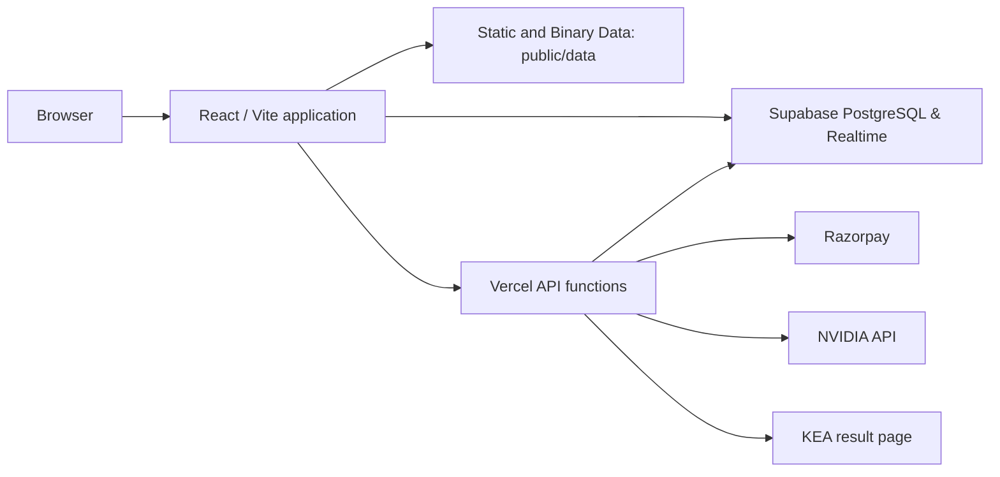

# KCETCoded Platform Documentation

## 1. Purpose and scope

KCETCoded is a web application dedicated exclusively to Karnataka CET (Engineering & Architecture) counselling research, admissions intelligence, and Karnataka 2nd PUC academic excellence. It brings together rank-estimation tools, multi-year cutoff exploration across 2023–2026, 2nd PUC syllabus and PYQ archives, college discovery, financial planning via the official KEA Fee Calculator, student utilities, community Q&A forums, and payment-supported access features.

It is an independent application. It is not an official KEA, COMEDK, college, examination-board or government service. Historical datasets and estimates are decision-support material only; users must verify admissions decisions against the relevant authority's current official publications.

This document covers the application in this repository: its deployed runtime shape, code organisation, routes, data, APIs, database integration and operating model as of October 2026.

## 2. System summary

| Area | Implemented approach |
| --- | --- |
| Client | React 18 single-page application written in TypeScript |
| Build | Vite 5 and SWC React plugin |
| Styling | Tailwind CSS 3, Radix UI primitives, Lucide icons, and local CSS |
| Mathematical Rendering | KaTeX (`katex.min.css`) for high-fidelity LaTeX equation rendering across the 68-chapter PYQ bank |
| In-Browser Document Rendering | Custom client-side HTML5 Canvas PDF viewer modal (`PdfViewerModal`) with 2D touch drag-panning and mobile zoom |
| Hosting / server functions | Vercel configuration plus serverless functions in `api/` |
| Shared backend | Supabase PostgreSQL, Realtime WebSocket broadcast (`kcet-forum-realtime`), and client SDK |
| Static & Binary data | High-performance cutoff vaults (`.dat` and `.bin`) and supporting JSON artifacts in `public/data/` |
| Payments | Razorpay order creation and signature verification with cross-device Pro cloud sync |
| AI services | TesselBot admissions assistant powered by NVIDIA Nemotron chat completion serverless proxy |
| Audio Engine | Floating background study music player powered by YouTube IFrame API with real-time Admin playlist management |
| Test tooling | Vitest and Testing Library |

The browser is the primary execution environment. Core cutoff searches read directly from pre-parsed binary vaults and static files, caching data locally for sub-100ms response times. Supabase provides shared records for reviews, forum threads, verified badges, live visitor tracking, poll responses, dynamic popups, and site shutdown/access controls.

## 3. Product domains

### 3.1 Admission intelligence & Cutoff Analysis
The application contains KCET rank-prediction and cutoff-exploration flows, a college predictor, a college-first cutoff view, trends, round prediction, and preference simulation. Historical cutoff coverage spans 252,789 records across 2023, 2024, 2025, and 2026 (including Mock 1 & 2, Round 1, Round 2, and Round 3 Provisional). Predictions are calibrated models based on official percentile reports and are not guaranteed outcomes.

### 3.2 2nd PUC Academic Hub
A complete study space under `/puc` integrating:
- Official state-prescribed 565+ page question banks (Physics, Chemistry, Maths)
- 2025 & 2026 solved PYQs with official KSEAB model answer keys
- 68-chapter complete KCET PCM question bank with LaTeX math formatting
- 30-mark practical scheme of evaluation rubrics
- Real-time 50% KCET PCM marks normalizer

### 3.3 Financial & Counselling Planning
- **Fee Calculator**: Incorporates the official KEA 2026-27 provisional fee structure, calculating 4-year tuition across Government, Aided, Unaided Type 1 & 2, Farm Science, and SNQ quotas alongside customizable hostel and living costs.
- **Mock Simulator & Verification**: Option-entry rehearsal tools and KEA document verification guidelines.

### 3.4 Community, Realtime Sync, & Engagement
- Real-time Discussion Forum with category tags and verified student badges.
- Cross-device Pro cloud sync on Google Sign-In.
- Global Community Polls and Admin Dynamic Popup broadcast system.
- Focus Music Player with study audio.

### 3.5 Operational Scope & Deprecated Suites
NEET Hub and COMEDK exploration tools have been decoupled and archived. Legacy routes redirect to `/` with an active `ScopeNotification` banner informing candidates of the focused KCET mission.

## 4. Runtime architecture

## 5. Route catalogue

All routes below are declared in `src/App.tsx`. “Shell” means the route is wrapped by `Layout`; “standalone” means it renders without that wrapper.

| Route | Page / behaviour | Presentation |
| --- | --- | --- |
| `/` | Homepage | Standalone |
| `/dashboard` | Dashboard command center | Shell |
| `/puc` | 2nd PUC Study Space Hub | Shell |
| `/puc/subjects` | Blueprints, chapter weightages, and teaching hours | Shell |
| `/puc/practicals` | Practical scheme of evaluation & lab rubrics | Shell |
| `/puc/question-banks` | Official 565+ page state question banks | Shell |
| `/puc/question-papers` | KSEAB Model Question Papers library | Shell |
| `/puc/marks-calculator` | PUC 50% KCET weightage calculator | Shell |
| `/puc/study-planner` | Board study planner | Shell |
| `/puc/pyq`, `/puc/pyq-archive` | 2025 & 2026 solved PYQs with official schemes | Shell |
| `/pyq`, `/pyqs` | Redirects to `/puc/pyq` | Redirect |
| `/pyq-test` | 68-chapter complete PCM PYQ practice engine | Shell |
| `/rank-predictor` | Calibrated KCET marks-to-rank predictor | Shell |
| `/cutoff-explorer` | High-volume 2023–2026 cutoff search engine | Shell |
| `/college-predictor` | Rank/category-driven college predictor | Shell |
| `/college-finder` | Redirects to `/college-predictor` | Redirect |
| `/cutoff-trends` | Multi-year historical cutoff graph visualizer | Shell |
| `/cutoff-predictor`, `/round-predictor` | Round drift prediction | Shell |
| `/fee-calculator` | KEA 2026-27 tuition and hostel fee calculator | Shell |
| `/mock-simulator` | Preference / allocation simulation | Shell |
| `/round-tracker` | Counselling-round guidance & reporting checklists | Shell |
| `/college-compare` | 24-category side-by-side college comparison | Shell |
| `/documents` | Mandatory verification documents checklist | Shell |
| `/document-verification` | Mock verification simulator | Shell |
| `/reviews`, `/reviews/:collegeCode` | Review list and college-specific review page | Shell |
| `/colleges`, `/college-list` | 269+ College information hub | Shell |
| `/college-cutoffs` | College-first cutoff matrix | Shell |
| `/college/:collegeCode` | College detail and branch roster | Shell |
| `/info-centre`, `/materials`, `/cet-news` | Information, resources, and curated news | Shell |
| `/blog`, `/blog/:slug` | Admissions Journal and counselling guides | Shell |
| `/ai-counselor` | TesselBot AI guidance UI with in-chat wizard | Shell |
| `/forum`, `/forum/:postId` | Real-time community discussion forum | Shell |
| `/donate`, `/supporters` | Donation and supporter surfaces | Shell |
| `/privacy`, `/terms`, `/payment-policy`, `/about` | Policy and product information | Shell |
| `/request-feature` | Community feature request submission | Shell |
| `/daily-challenge`, `/cutoff-clash` | Daily challenge and gamified intuition tools | Standalone |
| `/dino`, `/game` | Study break runner mini-game | Standalone |
| `/squad-finder`, `/metro-mapper`, `/bmtc-mapper`, `/hidden-gems` | Research and commute tools | Shell |
| `/admin` | Administration hub (access control, music, popups, shutdown) | Standalone |
| `/neet`, `/neetcoded`, `/neet-*` | Graceful redirect to homepage with scope notice | Redirect |
| `/comedk`, `/comedk-*` | Graceful redirect to homepage with scope notice | Redirect |
| `*` | Not-found fallback | Standalone |

## 6. Codebase map

| Path | Responsibility |
| --- | --- |
| `src/pages/` | Route-level views and feature workflows |
| `src/components/` | Shared UI, community widgets, analytical visualisations and admin panels |
| `src/lib/` | Business logic, predictors, data loading, parsers, security helpers and service wrappers |
| `src/contexts/` | Cross-cutting React context providers |
| `src/data/` | Embedded data, especially the PYQ bank and college metadata |
| `src/integrations/supabase/` | Typed Supabase client and generated schema types |
| `src/store/` | Lightweight shared predictor store |
| `api/` | Vercel serverless/edge endpoints |
| `public/` | PWA assets, SEO assets, downloadable/source data and static datasets |
| `scripts/` | Extraction, merge, inspection, validation, news and data-maintenance scripts |
| `supabase/` | Schema, migrations and Supabase CLI configuration |
| `reports/` | Data quality output artifacts |

The repository also contains raw PDFs, XLSX files, intermediate extraction artifacts, backups and debugging output at the root. These are useful for traceability but increase repository size and make a deliberate retention policy necessary.
